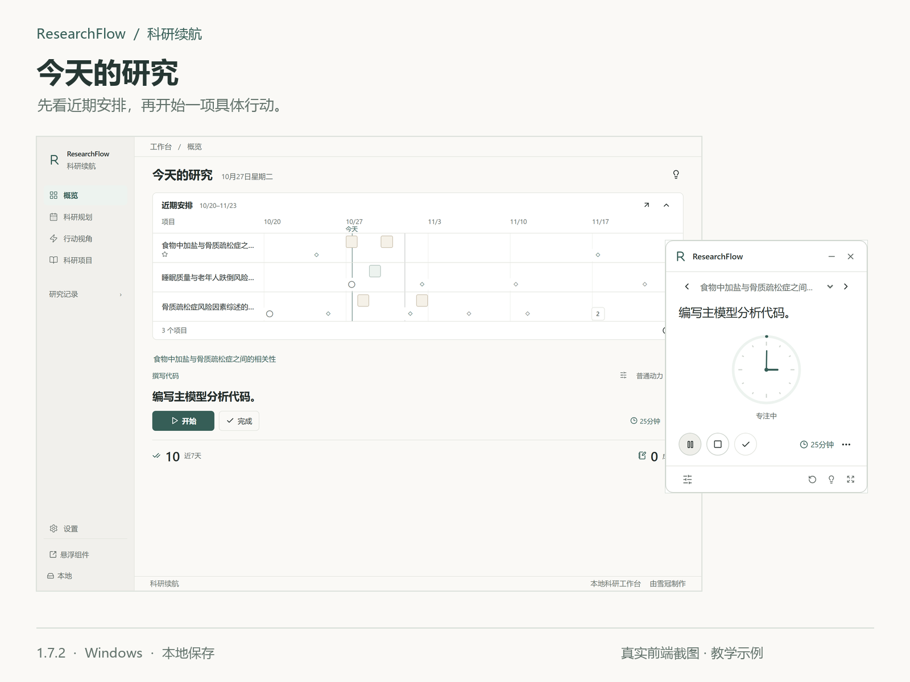
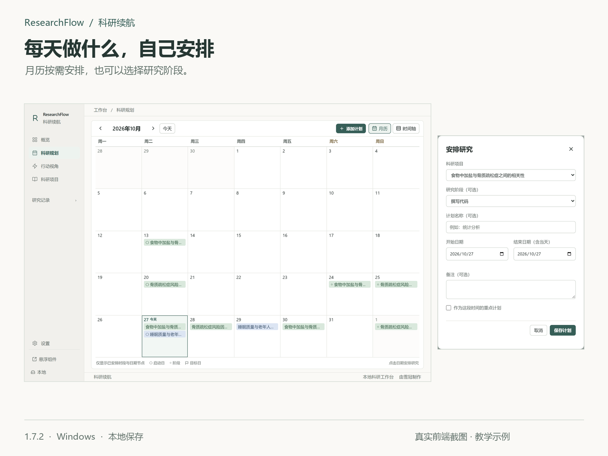
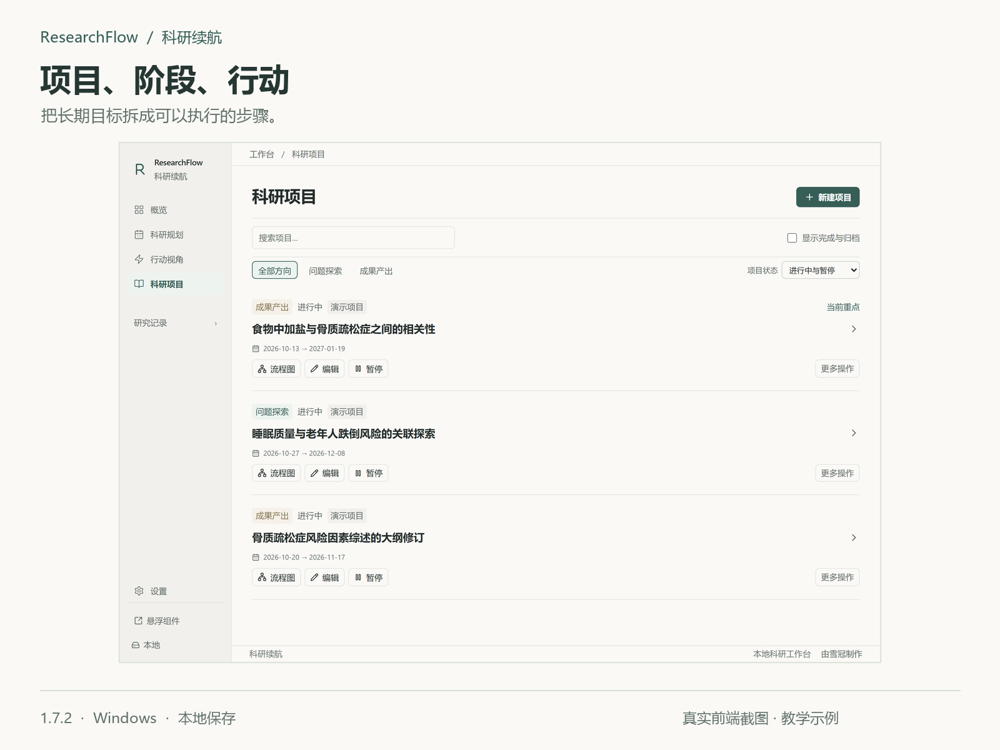
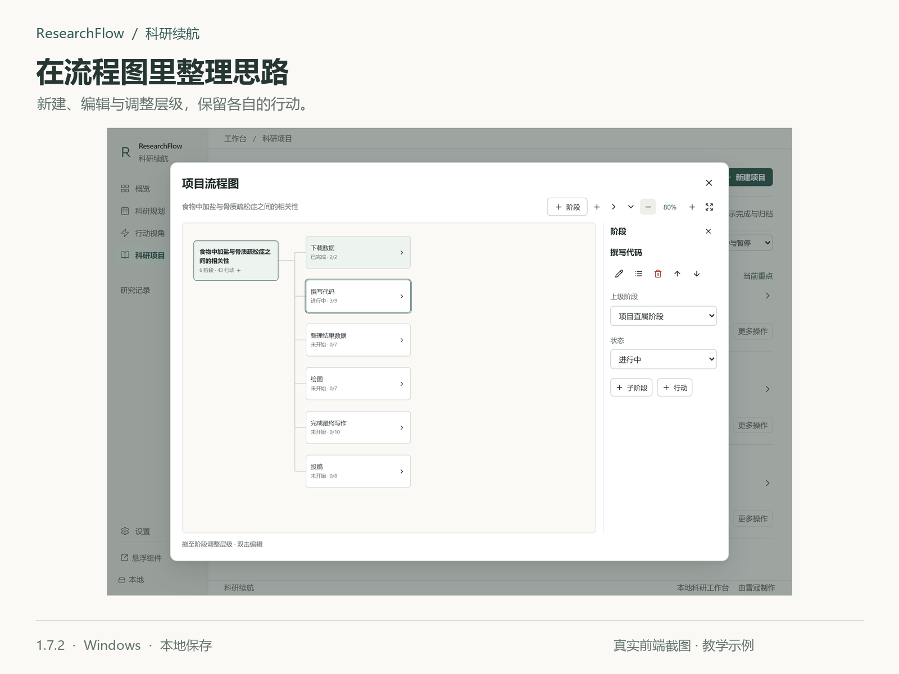
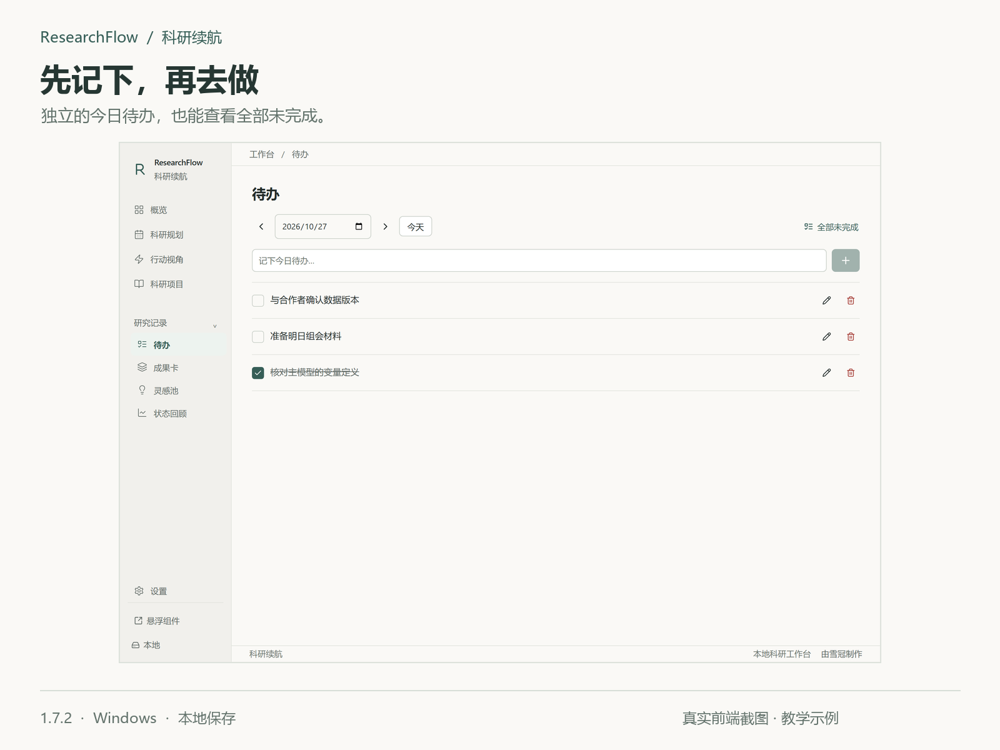
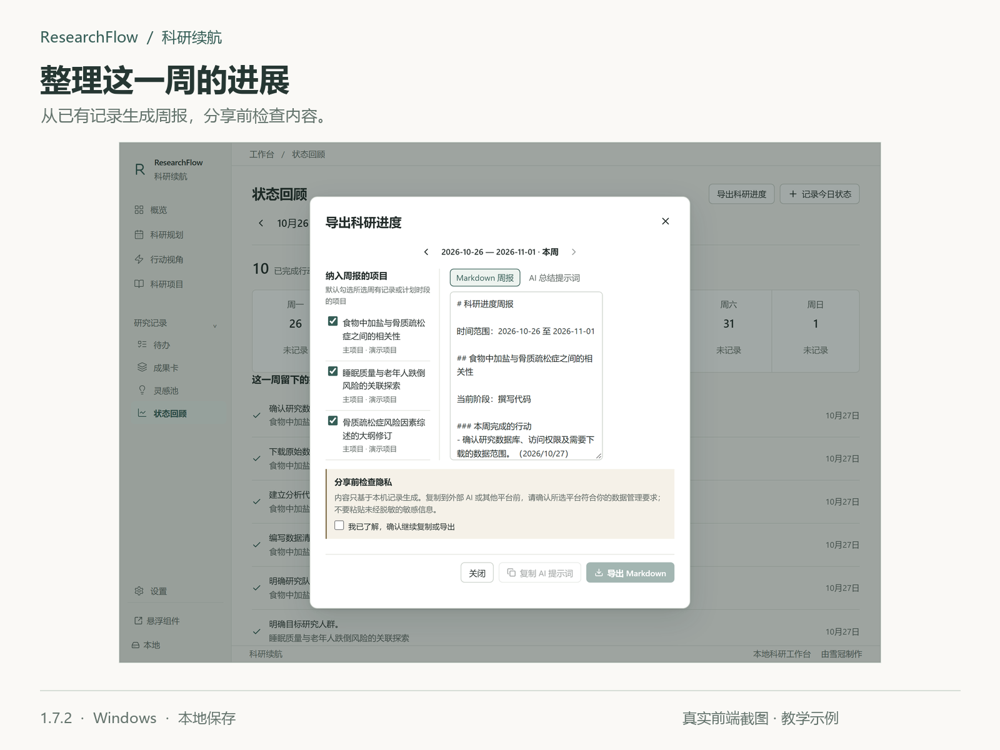

# ResearchFlow 科研续航

最近利用闲时vibe coding了一个面向科研人员的轻量级桌面软件【ResearchFlow（科研续航）】，主要重心在多科研项目管理与执行效率提升。

**Windows 10 / 11 x64 · 核心功能离线可用 · 无需账号 · 源码公开，非商业许可**

[下载 1.7.2](https://github.com/xk18/researchflow/releases/tag/v1.7.2) · [使用说明](docs/USER_GUIDE.zh-CN.md) · [安装与升级](docs/INSTALL.zh-CN.md) · [隐私说明](docs/PRIVACY.zh-CN.md)

## 为什么想要做这款小软件？

做这款软件的idea来源于我在自己做科研的过程中，遇到的一些烦恼与困惑：

1. 在科研项目初期干劲满满，但一个月过后就对重复的代码修正与反复实验耗尽了热情，导致效率一落千丈，久久无法推进；
2. 手头同时有多个项目，常常因为不知道如何为各个项目分配时间精力，而感到焦虑万分；
3. 一个项目因为不可抗拒原因被迫暂停一段时间，重新启动时却因需要复习整个项目带来的巨大的启动成本，一再拖延；
4. 得到了一个很好的灵感，却常常因为手头沉重的科研负担把它丢在一旁，过不久就忘之脑后了，再想捡起却怎么也整理不好思路

这些烦恼分别对应了软件里的几项功能：

| 上面提到的问题 | 对应的功能 | 具体怎么用 |
| --- | --- | --- |
| 第 1 条：热情消退，重复工作迟迟无法推进 | 双轨项目、阶段拆分、下一步行动、专注计时 | 将问题探索与成果产出分别管理，把代码修正、实验验证、论文写作拆成具体行动；选好一项后，在行动视角或悬浮窗开始专注。 |
| 第 2 条：多个项目，不知道如何分配时间精力 | 重点项目、科研月历、时间轴、主项目与子项目 | 确定这段时间的重点，查看各项目的日期与 DDL，再自己选择每天推进哪个项目、哪个阶段。 |
| 第 3 条：暂停后重新启动，梳理整个项目的成本太高 | 项目重启卡、文件线索、下一步行动 | 暂停前记下做到了哪里、还有什么问题、文件放在哪里、下次先做什么，回来时接着往下做。 |
| 第 4 条：灵感放到一旁，之后忘记或理不清思路 | 灵感池、关联项目 | 先记下想法和补充线索，等有时间继续研究时，再关联已有项目或建立新项目。 |

## 有哪些基础功能？

### 1. 宏观把控各项目进度

通过科研月历、时间轴和重点项目规划，把未来几周、几个月的科研安排直观展示出来。不仅知道手里有哪些项目，也知道现阶段应该以具体哪一个项目为重点、哪一些项目处在DDL临界，等等。

月历里每天做什么由自己安排。项目设置了起止日期，也不会自动填满中间的每一天。点击日期选择项目，还可以指定当天要推进的研究阶段；需要连续几天，再主动设置计划时段。

### 2. 拆分项目成可以立刻执行的小任务

一篇论文可以先拆成数据准备、代码编写、结果整理、绘图、论文写作等大阶段，再把每个阶段拆成具体的小任务，明确知道今天只需要推进哪一个具体步骤。这样大幅降低了项目的启动难度，提高了执行力。

例如“撰写代码”阶段，可以分别管理变量定义、主模型分析、敏感性分析和代码检查。阶段与行动可以排序，也可以在流程图里新建、编辑和调整层级。

### 3. 双轨项目制——兼顾科研探索与成果产出

将科研项目分为「问题探索」和「成果产出」两条线，确保研究者不要因为对新项目的热情消退，就将需要进行后期代码修正、实验验证和论文写作等稍显枯燥重复的工作的项目搁置一旁。

### 4. 设立重点项目，进行优先级排序

同一阶段分别确立一个重点探索项目和一个重点交付项目，配合科研月历、时间轴和 DDL 规划未来的工作。抓住主要矛盾，明确这段时间应该将哪些项目作为主线、重点突破什么，避免在多个项目间反复横跳。

有联系的工作可以整理为主项目和子项目，各自保留阶段、行动与时间安排。在行动视角或悬浮窗切换项目后，可以查看对应的下一步行动；专注支持正计时和倒计时。

### 5. 降低启动成本，减少内耗

利用项目重启卡记录已经完成的工作、尚未解决的问题、关键文件和下一步行动，相当于搁置每个项目前进行一次存档。即使项目因为各种原因暂时搁置，也尽量不用每次都从头梳理，减少重拾项目时面对庞大工程的拖延。

### 6. 记录妙手偶得的科研灵感

将突然冒出来的新想法先记录下来，等合适的时候再继续探索，不必因为当前工作繁忙就让一个可能有价值的研究方向白白溜走。

### 其他日常功能

- **待办**：在“研究记录”随手记下准备组会材料、确认数据版本等临时事项，可以修改日期、完成或重开，也可以集中查看全部未完成。不需要为每件小事新建项目。
- **成果卡与状态回顾**：记录阶段成果，按自然周整理实际完成的行动、专注和研究记录，导出 Markdown 周报或外部 AI 总结提示词。
- **外部 AI 计划导入**：复制提示词到自己选择的外部 AI，讨论并确认计划后，将 JSON 导入项目。软件不直接连接 AI 服务，也不需要 API Key。
- **示例项目**：首次使用时可自主加载三个科研示例，查看完整阶段和行动，也可从空白开始；之后仍能加载、编辑或移除示例。
- **外观与备份**：默认浅色，支持深色、全局字号和寄语设置；科研记录可以导出 JSON，在兼容版本中恢复。

当前版本为 1.7.2，具体改动见 [版本说明](docs/RELEASE_NOTES.1.7.2.zh-CN.md)。

## 下载与开始

在 [Releases](https://github.com/xk18/researchflow/releases/tag/v1.7.2) 下载 `ResearchFlow_1.7.2_x64-setup.exe`。也可以下载分享 ZIP，里面附有说明书。GitHub 的 **Code → Download ZIP 是源码，不是安装包**。

首次打开可选择体验三个完整示例，或直接创建自己的项目。示例可正常编辑，之后可在设置中安全移除。已有研究记录的用户不会被自动加入示例。

运行要求为 Windows 10 / 11 x64 和 Microsoft Edge WebView2。电脑缺少 WebView2 时，首次安装可能需要联网下载；安装后核心功能可离线使用。**当前 1.7.2 安装包未做代码签名**，Windows 可能提示未知发布者或阻止运行。请核对来源及校验清单，并遵守所在单位的设备管理要求。

## 数据与隐私

科研记录保存在当前 Windows 账户的本地目录，无需登录，没有云同步、内置 AI 模型、应用遥测或科研内容自动上传。外部 AI 功能由你主动复制提示词、确认计划后导入 JSON，软件不直接连接 AI 服务。

本地 JSON **没有应用层加密**。备份、周报、截图和复制给其他平台的内容也可能含有未公开信息，请自行检查分享范围。软件备份不包含所记录路径指向的数据集、脚本和文档。[隐私与数据安全](docs/PRIVACY.zh-CN.md)

升级前建议导出 JSON、保存输入并从托盘完全退出旧版。1.7.2 沿用原应用标识和数据目录，正常首次读取新版时会保留旧数据副本；软件没有自动更新服务。[安装、备份与升级](docs/INSTALL.zh-CN.md)

## 开发与反馈

使用 Tauri 2、Rust、React 和 TypeScript。[构建与检查](docs/DEVELOPMENT.zh-CN.md) · [常见问题](docs/FAQ.zh-CN.md) · [参与说明](CONTRIBUTING.md)

欢迎通过 [Issues](https://github.com/xk18/researchflow/issues) 提交使用体验、Bug 和功能建议。请不要附上真实科研 JSON、患者信息、密钥或未脱敏截图。涉及可被滥用的漏洞请参阅 [安全报告说明](SECURITY.md)。

这个个人项目仍在持续打磨。有些设计可能还不成熟，欢迎告诉我哪些地方不好用、哪些功能其实没有必要。

## 许可与作者

由 **雪冠** 制作 · [GitHub @xk18](https://github.com/xk18)

使用 [PolyForm Noncommercial 1.0.0](LICENSE)。允许许可范围内的非商业使用、修改和分发，须保留许可及 [版权通知](COPYRIGHT.txt)；商业用途需要另行获得许可。该许可不属于 OSI 定义的开源许可。第三方组件分别遵循 [第三方许可通知](THIRD_PARTY_NOTICES.txt)，不因本项目许可改变。

## English

ResearchFlow is a local-first Windows app for managing research projects, stages, actions, schedules and notes. It includes an editable workflow map, daily to-dos, focus timers, restart cards and weekly reports. No account is required. Core features work offline. Source available under PolyForm Noncommercial 1.0.0. The Windows installer is currently unsigned.

Screenshots show the actual 1.7.2 browser frontend with isolated teaching examples. They do not contain the author's private research records or represent scientific findings. See [screenshot notes](docs/images/product/README.md).
