# ResearchFlow 科研续航
## 新手使用说明书
版本 1.7.2 · Windows 10 / Windows 11 x64 · 更新于 2026-10-27

让未来的计划，落到现在可以开始的一步。

ResearchFlow 把项目、科研规划、具体行动、专注记录和研究线索保存在你的电脑上。你可以只用“项目 + 行动”，也可以逐步加入计划和阶段，不需要一开始填完所有内容。

### 第一次使用：先完成这五步

1. 安装并启动 ResearchFlow。
2. 全新用户启动后会自动打开完整欢迎页；平时从悬浮卡片右下角进入“管理面板”。
3. 选择“体验示例科研项目”学习，或“创建我的第一个科研项目”；也可“暂时跳过”。
4. 为项目添加一项具体行动，例如“核对一组变量的缺失值”。
5. 在“行动视角”选择该项目，点击“开始”；工作后选择“结束”或“完成”。

### 如何阅读这份说明书

| 你想做的事 | 查看章节 |
| --- | --- |
| 安装并开始使用 | 01 安装与第一项行动 |
| 找到窗口、调整桌面习惯 | 02 窗口与导航 |
| 安排未来一个月或三个月 | 03 科研规划 |
| 把项目拆成研究阶段 | 04 项目路线图 |
| 自定义90分钟或正计时 | 05 专注与行动状态 |
| 主项目、阶段排序和研究记录 | 04 项目路线图、06 研究记录 |
| 生成科研进度周报 | 06 研究记录 |
| 使用外部 AI 规划项目 | 04 项目路线图中的“AI 科研计划导入” |
| 备份或换电脑 | 07 数据与备份 |
| 分享软件给别人 | 08 分享与安装 |
| 处理常见问题 | 09 常见问题与日常用法 |

本版新增截图来自真实浏览器运行的桌面前端；部分未变化功能沿用此前截图。图中内容为演示科研场景，不会自动加入你的项目。按钮名称以当前1.7.2版为准。

<!-- page -->

# 1.7.2 新功能

### 今日待办

研究记录 → 待办。输入一件事，按Enter或点击“＋”保存。勾选表示完成，再点可重新打开；铅笔可编辑内容或日期，删除需要确认。日期箭头查看前后日，“今天”返回本地今日。“全部未完成”汇总各日未完成事项，不会因跨日自动删除或完成。

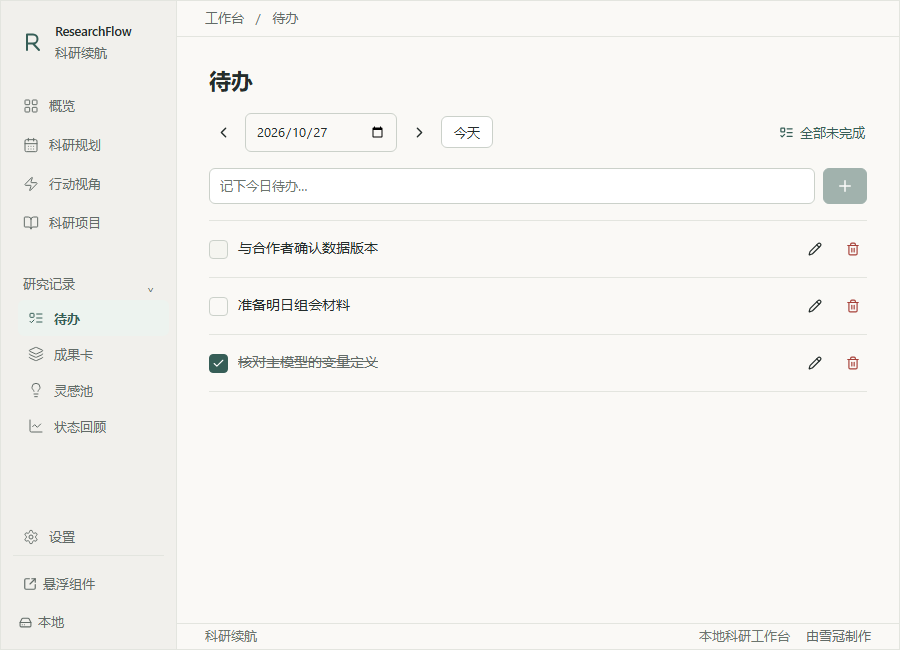

待办是独立清单，不会生成科研项目或项目行动，也不影响阶段进度。待办包含在JSON备份、恢复和合并中，升级前已有科研项目保持原样。

### 月历按需安排

项目启动日期和目标日期作为节点展示，中间日期不再自动填入该项目。点击日期 → “在这一天安排研究”，选择项目和可选研究阶段。默认只安排所选当天，也可以主动改为多日。新计划默认不勾选“作为这段时间的重点计划”。

所选日期在项目起止范围内的进行中项目优先列出，其余项目仍可选择。已有计划时段继续按原日期显示；时间轴继续保留项目整体起止范围。

<!-- page -->

# 在流程图中编辑项目

科研项目 → 流程图。点击节点打开侧栏，双击打开编辑器。点击顶部“＋阶段”或根节点创建阶段，旁边“＋”添加未分组行动；选择阶段后可新建子阶段或行动。

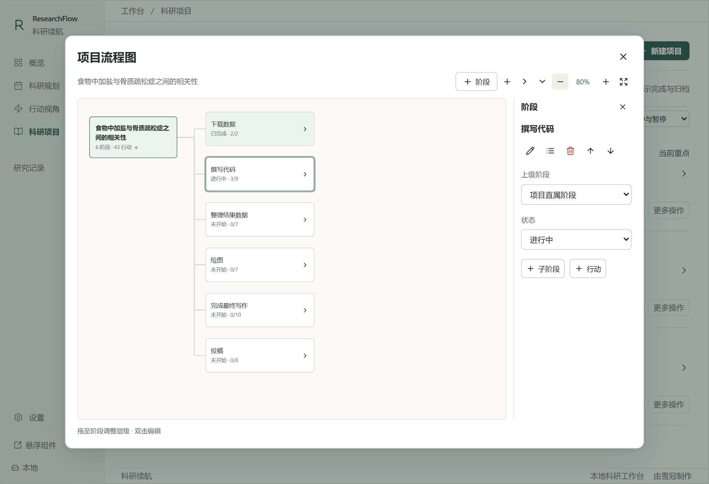

- 拖动阶段到另一个阶段，将其设为子阶段；拖到项目根节点，恢复项目直属层级。
- 拖动行动到阶段，调整行动归属；拖到项目根节点移至未分组。
- 不便拖动时，选中节点，在侧栏用“上级阶段 / 所属阶段”下拉框调整；上移、下移仅改变同层顺序。
- 侧栏可编辑阶段状态、完成或重新打开行动；完成行动不会自动完成阶段。
- 删除阶段需确认：行动移至未分组，直属子阶段提升一级，其他研究记录保留。
- 顶部支持展开、收起、缩放和适应宽度。大图使用滚动条；“在列表中打开”返回原路线图或行动编辑器。

层级仅表示所属关系，不表示任务依赖、自动执行顺序或自动完成。子阶段仍分别保存状态、日期和行动，不会继承上级阶段状态。主项目 / 子项目仍只支持一级，与阶段层级相互独立。

循环、自引用、跨项目或失效阶段关联在写入前拒绝。旧版平面阶段保持原样，已有ID、日期、成果和专注记录保留。AI计划交换格式仍为平面阶段，导入后再在流程图调整。

升级沿用同一Windows账户的数据目录；首次读取新版前保留原文件与窗口偏好至 `backups/before-1.7.2/`。可在设置预览升级前副本。备份不包括路径指向的外部数据集或文档。

<!-- page -->

# 入门：用三个完整示例理解科研工作流

### 自主开始

全新用户启动后会自动打开欢迎页。“体验示例科研项目”保存三个完整示例后进入概览，近期科研时间轴、当前阶段与下一步行动读取同一份记录；“创建我的第一个科研项目”打开新建表单，成功保存后完成引导，取消则回到欢迎；“暂时跳过”只记录这次选择，不创建示例，之后可正常使用且不重复引导。

欢迎页下方的“本地保存、离线可用、无需登录”介绍核心使用方式；“隐私详情”打开可随时阅读的说明，不需要同意隐私协议才能开始。老用户升级、删空项目或恢复旧备份，都不会自动注入示例或强制再次欢迎。

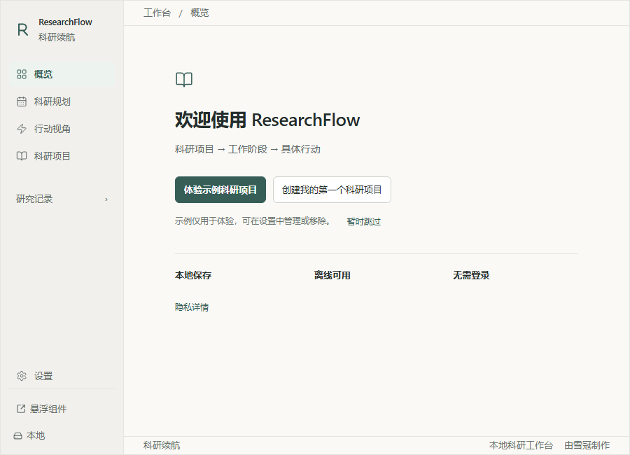

### 认识项目、阶段和具体行动

| 示例项目 | 阶段与当前工作 |
| --- | --- |
| 食物中加盐与骨质疏松症之间的相关性 | 下载数据 → 撰写代码 → 整理结果数据 → 绘图 → 完成最终写作 → 投稿。下载数据演示为完成，撰写代码进行中；主模型与敏感性分析独立管理。 |
| 睡眠质量与老年人跌倒风险的关联探索 | 明确研究问题 → 评估数据可行性 → 形成初步研究方案 → 开展可行性验证 → 确定后续研究方向。第一阶段进行中。 |
| 骨质疏松症风险因素综述的大纲修订 | 梳理现有综述大纲 → 调整整体章节结构 → 完善证据组织方案 → 形成修订版大纲 → 修改与最终交付。第一阶段完成，第二阶段进行中。 |

点击项目名称展开路线图，再点击阶段标题查看行动。可以编辑、完成行动或点击播放按钮开始专注。阶段状态与项目完成仍需单独确认。示例完成标记只说明教学进度，软件没有下载数据或得出科研结果。

示例计划根据主动加载时的本地日期生成，保存后不会随着重启漂移。概览、月历、时间轴和行动视角使用同一份记录。

### 随时加载与安全移除

设置 → 示例科研项目：可加载全部示例或补齐已移除的示例，不覆盖仍存在的修改内容。“移除示例项目”会列出项目与关联记录数量；未改动示例默认勾选，编辑过或新增成果、专注等内容的示例默认保留。

可以“保留为普通项目”，它会保留所有内容并解除演示标记；同一来源的示例不再重复生成。若明确要删除修改后的示例，需要额外勾选确认说明。其他真实项目（包括同名项目）保持原样。有未结束的专注或确认期间的新编辑时会阻止删除。

移除前保存本地安全副本。必要时可从备份与恢复 → 恢复导入前副本查看和恢复；它会回到整份工作区的副本时点，恢复前请先导出当前JSON。

<!-- page -->

# 01 安装与第一项行动

### 安装准备

使用 Windows 10 或 Windows 11 的64位电脑。运行安装包 ResearchFlow_1.7.2_x64-setup.exe，按向导安装，再从开始菜单或安装时创建的快捷方式打开。普通用户无需安装 Node.js、Rust 或开发工具。

软件需要 Microsoft Edge WebView2 Runtime。已有运行库时可直接安装；没有时安装向导会下载，首次安装可能需要网络。安装后核心功能可离线使用。当前安装包未做商业代码签名，Windows可能显示未知发布者；请先确认文件来自可信提供者。

### 新建一个科研项目

1. 打开“科研项目” → “新建项目”。
2. 输入名称，例如“实验研究论文初稿”。
3. 选择工作方向：“问题探索”用于提出问题、尝试方法和验证假设；“成果产出”用于整理结果、撰写论文或完成报告。
4. 按需填写背景、项目启动日期和目标完成日期；需要优先推进时勾选“设为当前重点”。
5. 点击“保存项目”，看到保存成功提示后再离开。

### 添加一个容易开始的行动

点击项目名称展开详情，使用“添加行动”；也可在行动视角使用“添加行动”。写一个具体动作，例如“检查实验记录中的异常值”，比“完成论文”更容易执行。备注可写第一步或文件线索，阶段和预计总工作量可以不填。

然后进入“行动视角”，在“当前科研重点”中选中项目，点击“开始”。没有计划或阶段性目标也能正常工作。

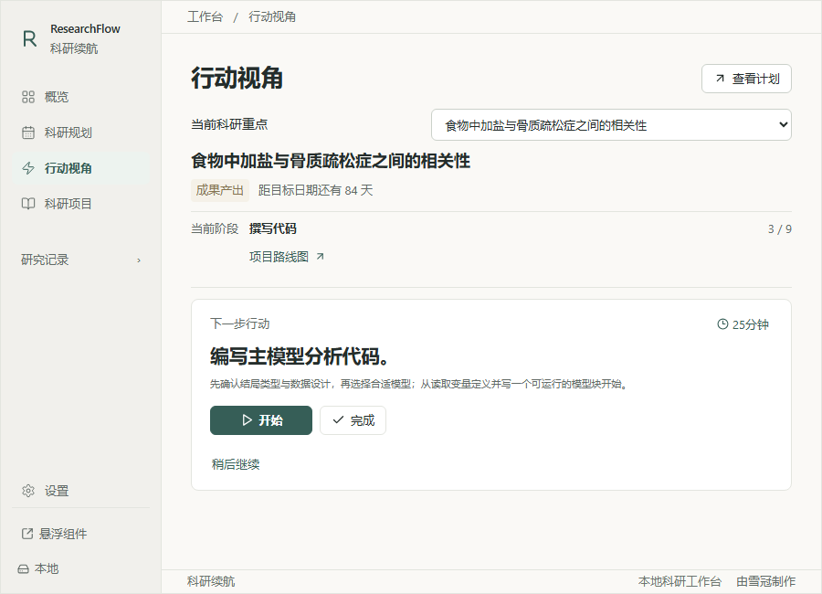

<!-- page -->

# 02 窗口与导航

### 三种窗口，适合不同工作时刻

| 窗口 | 用途 | 操作 |
| --- | --- | --- |
| 桌面卡片 | 查看下一步行动、开始专注 | 卡片右下角“管理面板”打开完整窗口 |
| 收起胶囊 | 暂时减少桌面占用 | 点击卡片减号收起；点击胶囊展开 |
| 管理面板 | 编辑项目、计划、阶段和记录 | 侧栏切换页面；较长内容向下滚动 |

卡片顶栏空白处可以拖动；胶囊右端拖动柄用于移动。卡片关闭按钮会隐藏到系统托盘，管理面板关闭按钮只隐藏面板。需要找回时，在Windows右下角托盘找到R图标（可能藏在上箭头内），点击恢复；再次启动软件也会恢复组件。

**彻底退出：** 保存表单后，在托盘右键菜单选择“完全退出”，或进入“设置” → “完全退出”。退出前的未保存表单不能当作已保存记录。

### 侧栏入口速查

| 入口 | 什么时候用 |
| --- | --- |
| 科研规划 | 安排日期，查看月历和时间轴 |
| 行动视角 | 选择当前项目，开展下一步行动 |
| 科研项目 | 创建、编辑项目，按方向和状态筛选，查看路线图和行动 |
| 研究记录 | 按需打开待办、成果卡、灵感池和状态回顾 |
| 设置 | 主题、置顶、开机启动、备份恢复 |

“重启卡”从暂停项目筛选和概览中的“继续上次”进入；问题探索与成果产出在科研项目页作为方向筛选，不再占据主导航。旧版页面链接仍可打开。

在项目操作区点击“取消重点”，会一并释放该项目的重点计划和手动聚焦，保留科研记录。点击另一项目的“设为重点”即可切换当前聚焦；允许保留多个重点项目。取消重点不会暂停或归档项目。

首次无主题偏好时默认浅色；升级会保留已选择的深色或跟随系统。在“设置”中可选浅色、深色或跟随系统。置顶与开机启动默认关闭，需要时自行打开。

“状态回顾”中的“导出科研进度”按自然周预览你选择的项目记录，可切换到较早的一周。默认勾选该周有行动更新、计划时段、专注、成果或问题记录的项目；也可手动调整。生成的Markdown或外部AI总结提示词只在本机整理，复制或导出前需要确认隐私提醒。提示词要求外部AI区分事实、进行中事项、待确认问题和下一步，不推算完成比例或编造结论。

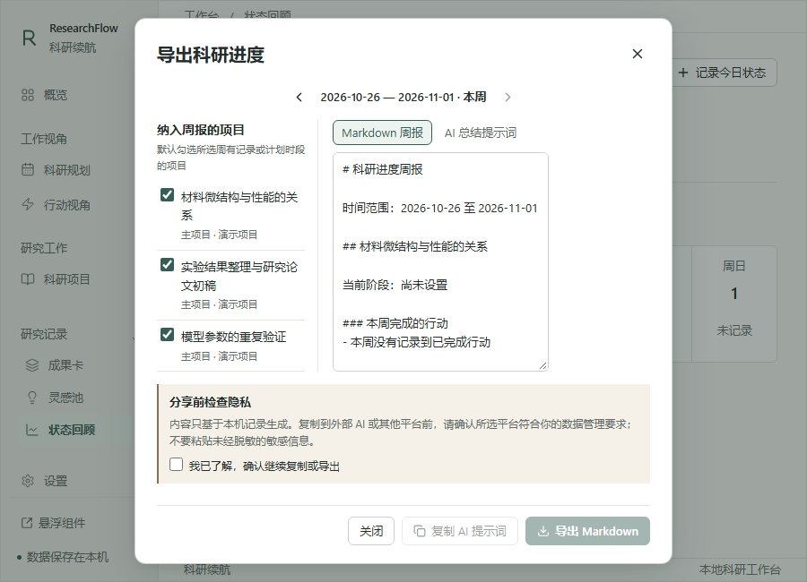

<!-- page -->

# 03 科研规划：把未来安排清楚

### 先从概览看近期安排

“概览”顶部显示近期科研时间轴：过去7天，加从今天起的28个自然日，共35天。它读取科研规划中的同一份项目日期、独立计划时段和阶段日期；今天来自电脑本地日期。

填色条表示明确安排的推进时段，空心虚线条表示项目总体日期，不能当作每天持续投入。项目有独立时段时只画这些实际时段，保留中间空档。菱形是阶段节点，旗标是项目目标；多个相近节点会合并为数字，点击可查看每个原始日期和阶段。暂停项目仍保留近期计划并标明“已暂停”，完成、归档和终止项目从近期工作中隐藏。

概览以“今天的研究”为标题。时间轴通常预览3个近期项目，窗口高度不超过600像素时预览2个，优先显示手动主线、未结束专注和近期重要安排。左侧项目名可截断，鼠标悬停或键盘聚焦可查看完整名称。每个项目最多显示一处时段名称；重叠安排从“另 N 段”查看，不会把不连续时段连接起来。

点击项目名称或时间条查看项目；点击阶段节点会展开并定位路线图阶段。“完整规划”打开对应月份的三个月时间轴，可查看全部项目，浅色背景标出概览范围。查看计划不会切换专注项目或停止计时。未安排日期的重点项目仍有查看入口；它不会被画出虚构时段。可从“图例”查看符号含义。

可收起时间轴，软件记住这个界面偏好。收起状态显示近期项目总数；偏好不属于科研备份，也与悬浮卡片的收起状态独立。

### 从当前研究开始一步

时间轴下方连续展示当前研究、行动所属阶段和下一步行动。阶段来自这项行动的实际关联，未关联阶段时显示“未分组行动”。项目、阶段和行动仍需分别确认完成。若其他项目还有未结束的专注，概览优先显示该会话，并说明手动主线仍然保留。

点击“开始专注”开始计时；“完成行动”标记任务完成，“结束专注”只保存本次计时。行动说明收在时长旁的“⋯”（行动详情与选项），可查看全文、编辑或暂缓推荐。点击时长可设90分钟或正计时；动力选择器保留原有推荐功能。“行动视角”用于切换主线和查看完整行动列表。

底部“查看成果卡”进入研究记录。有暂停项目时显示“继续上次”，从“找回研究思路”打开重启卡。记录灵感入口保留在页面右上方。

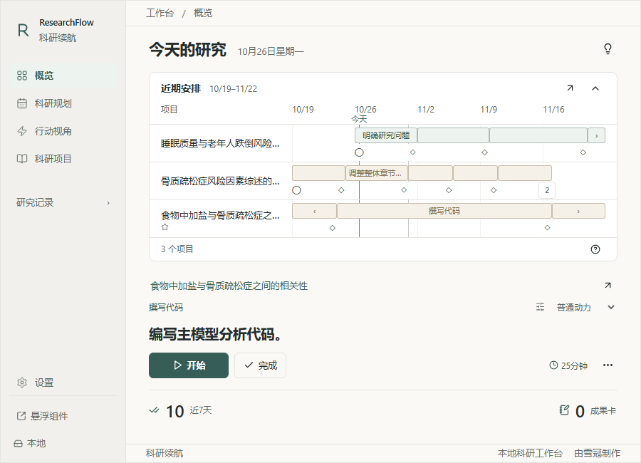

今天和剩余天数读取电脑本地日期与时区，不请求联网时间，也无需在软件内设置当前时间。请在Windows中保持日期与时区正确。

<!-- page -->

# 03 科研规划：月历与时间轴

### 项目日期与每日安排

在“科研项目 → 编辑”设置项目启动日期和目标完成日期。月历分别用“○”和旗标显示当天节点，**不会自动填充两者之间的每日**。时间轴仍显示项目总体范围，点击总体日期条可编辑项目；这个范围不表示每天持续投入。

已经保存的独立计划时段全部保留，仍在其日期内显示。需要减少旧计划的天数时，可主动编辑或删除对应时段；升级不会代你清空已有安排。

### 新建或调整计划

1. 点击月历中的日期，选择“在这一天安排研究”。
2. 项目下拉框优先显示所选日期位于起止范围内的进行中项目，其他进行中项目也可选择。未设起止日期仍能安排。
3. 可选择该项目的研究阶段；切换项目会清空阶段选择，避免错误关联。
4. 默认起止日都是所选当天。名称与备注可留空，也可主动安排多个日期；开始和结束当天均计入。
5. 新计划的重点勾选默认为空；编辑已有计划保留它原本的重点设置。保存后显示标签，悬停查看项目、阶段和时段全名。

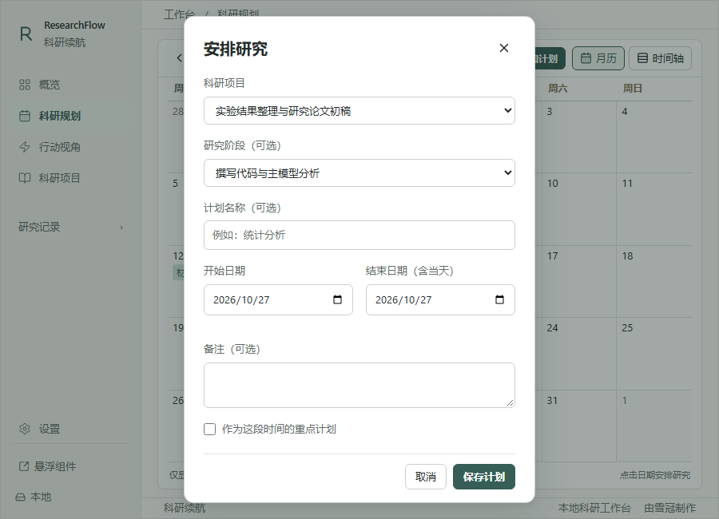

点击单个无其他节点的标签可编辑；同项目多时段或日期节点并存时，先进入当天详情，再选择具体记录。时间轴上的计划条也可编辑。删除阶段只解除计划的阶段关联，计划本身、日期和备注保留。

<!-- page -->

# 03 科研规划：阅读月历与时间轴

| 视图或标记 | 含义 |
| --- | --- |
| 月历 | 自然月、周一起始；箭头换月，“今天”回到当前月 |
| 整格淡青灰 | 今天；日期数字与网格对齐 |
| 日期边框 | 当前选中的日期，不一定是今天 |
| 每日彩色短标签 | 一个项目在主动安排的日期各显示一张小纸签；同一项目颜色稳定，不会覆盖格线 |
| ○ / ◇ / 旗标 | 项目启动日 / 阶段节点 / 目标完成日期；项目目标只在对应日期标记 |
| “+N 项” | 当前格子还有更多项目；点击查看当天全部安排 |
| 时间轴 | 切换单月或三个月，展开项目看阶段；窄窗可横向滚动 |

月历只改变展示，不会因跨十几天而复制项目数据。同一项目的多个独立时段在同一天共用一个识别标签，详情中仍保留各条原始计划。鼠标停留在截断标签上可查看全名和日期；点击日期数字或空白处查看当天安排。窄窗口或高缩放时，月历区域可以局部滚动。未设置日期的项目和阶段仍可使用，不会被画出虚构的计划；到期不会自动完成项目。

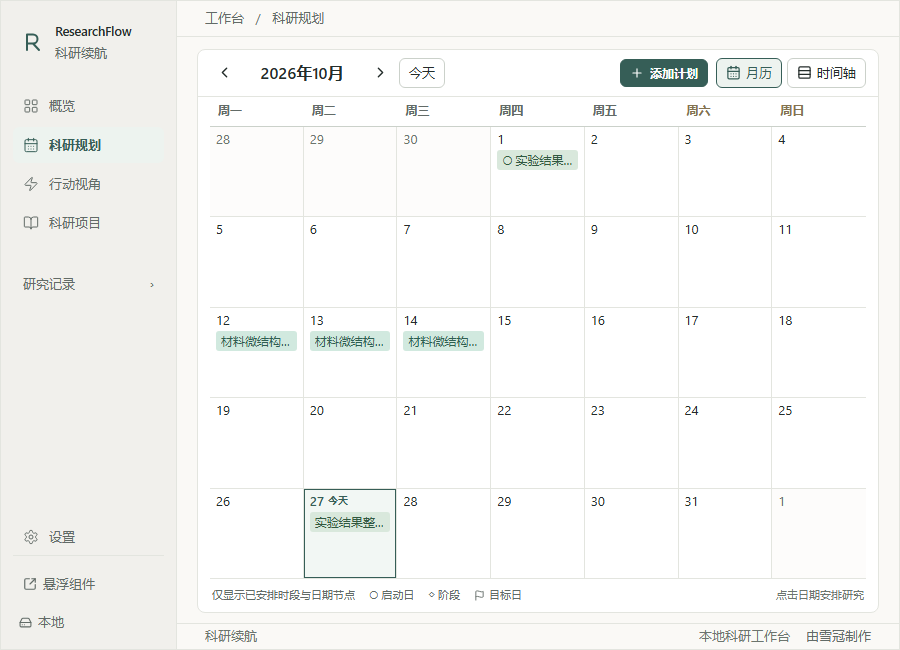

<!-- page -->

# 04 项目路线图：从阶段找到行动

在“科研项目”中点击项目名称展开，找到“项目路线图”。阶段是可选的，适合持续数周的研究；简单项目可以保留未分组行动。

### 主项目、子项目与排序

编辑项目时可选一个所属主项目。第一版只支持一级关系；子项目仍独立管理自己的阶段、行动、日期、成果和专注，不会自动继承主项目状态。项目列表按主项目分组，子项目轻量缩进显示，搜索仍能直接找到子项目。删除主项目会保留子项目及其记录，只解除所属关系。

阶段和行动可拖动排序；也可以用“上移 / 下移”按钮完成键盘操作。行动只在当前阶段或未分组行动列表中排序，不会改变阶段归属。排序不改变行动状态、日期、专注记录或完成逻辑。

### AI 科研计划导入

1. 展开进行中或已暂停的项目，点击“AI 科研计划导入”。在“补充项目资料”填写类型、时间、研究问题、研究成果、进展、资源限制和规划范围。名称与已有目标日期会自动带入；不确定的内容写“尚未确定，请 AI 协助讨论”。

2. 点击“复制提示词”。填写资料会自动进入提示词最前面；有缺失时可返回填写，或主动复制待填模板，在发送给 AI 前替换【待填写】标记。展开完整提示词可修改协作要求，修改资料不会覆盖自定义要求；两个步骤的复制按钮使用相同文本。

3. 与你选择的外部 AI 讨论大阶段目标、阶段成果和具体行动。小目标写成阶段内行动，备注写完成标准或第一步。确认后发送“计划已确认，请输出 ResearchFlow 格式”，让 AI 交付 UTF-8 的结构化 JSON 文件；无法生成附件时复制完整 JSON 文本即可。

4. 回到软件粘贴或选择文件，解析预览后逐项选择阶段与行动。可映射到已有阶段，仅追加行动；现有内容不被改写。确认后一次保存。没有单次参考时长的行动会以10分钟创建。

填写资料仅保留在本次导入窗口，关闭后需重新填写；关闭未保存编辑会提示。软件不连接 AI，不会自动附带已有记录。发送到第三方平台前检查保密资料。最近一次导入前的完整数据副本可在“设置 → 备份与恢复”恢复；其他科研记录也会回到该副本时点。

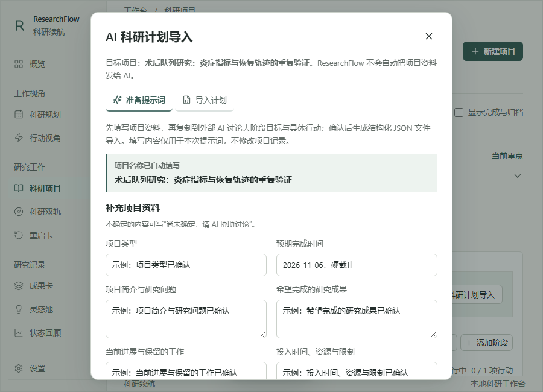

<!-- page -->

# 04 项目路线图：导入与阶段管理

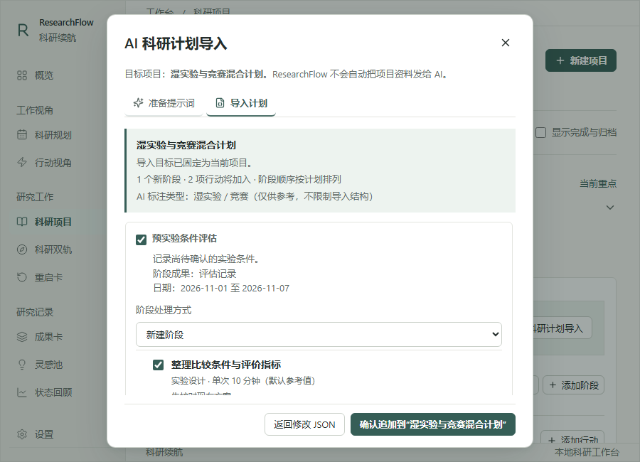

### 添加阶段与行动

1. 点击“添加阶段”，填写名称；说明、预期成果和日期按需要填写。
2. 或点击“批量添加阶段”，每行写一个名称，查看预览后确认创建。一次最多50项；重复名称会提示但可保留。
3. 点击阶段标题展开，使用阶段内“添加行动”；已有行动可在编辑时选择“所属阶段性目标（可选）”。
4. 用上移、下移调整顺序；根据实际工作手动选择“未开始”“进行中”或“已完成”。

例如，一项实验研究可以拆成：数据库下载、数据清洗、分析代码、主要模型、结果验证、图表整理、论文初稿、修改与交付。

**预期成果**写能判断阶段是否结束的产物，例如“可复现的清洗数据集与变量说明”，而不只写“分析完成”。

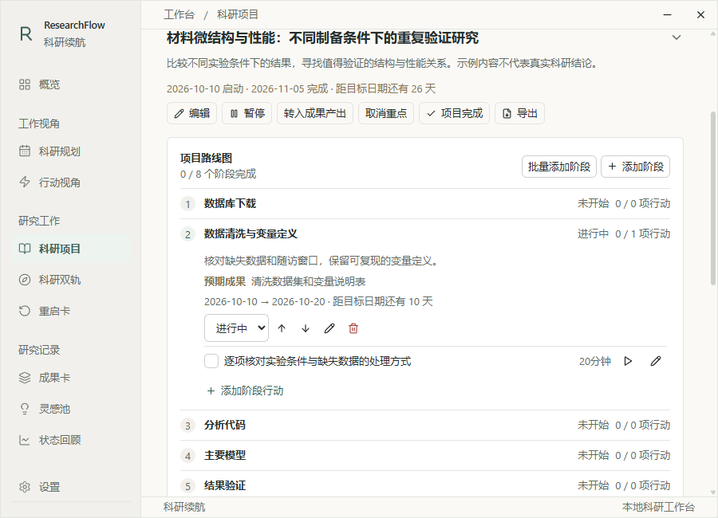

### 进度与删除规则

“2 / 5项行动”统计已完成行动，不代表论文完成40%。完成所有行动后，仍需由你确认阶段是否完成；完成阶段也不会自动完成项目。

删除阶段需确认，阶段内行动保留并回到未分组。删除整个项目会连带删除关联记录，操作前建议导出JSON备份。有专注历史的行动可更改阶段，但保持原项目归属；需要放到其他项目时请新建行动。

<!-- page -->

# 05 专注：分清“结束”和“完成”

在行动视角或桌面卡片中点击时长（如“25分钟”），选择本次计时方式。

- **倒计时：** 输入1至240的整数分钟，或选5、10、20、45、60、90分钟。
- **正计时：** 不预设结束时间，从零累计，适合难以估计时长的工作。
- **预计总工作量：** 在行动编辑中填写，如360分钟；它与本次90分钟会话独立。

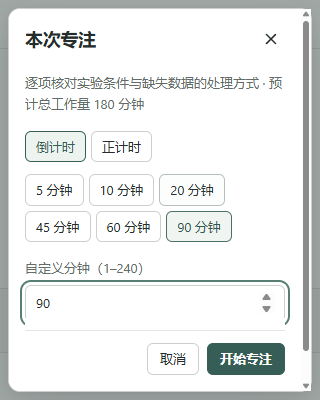

### 按钮的含义

| 按钮 | 实际结果 |
| --- | --- |
| 开始 | 创建本次专注会话，开始累计 |
| 暂停 | 暂停累计，保留同一会话 |
| 继续 | 继续暂停的会话 |
| 结束专注 | 保存这次投入，行动仍可以下次继续 |
| 完成 | 把行动标记完成，并结束其当前会话 |

一次只有一个可继续的会话。切换到另一行动前先结束当前会话。倒计时到点会暂停，等你选择结束或继续工作，不自动完成行动。没有计时，也可以直接把已做完的行动标为完成。

同一行动可分多次专注；在行动编辑中展开“专注历史”查看。隐藏到托盘不会等同于暂停；完全退出会保存并暂停，重启后需要确认继续。

计时使用Windows单调时钟，修改系统日期不会使累计跳变。活动会话有约30秒保存检查点，意外断电可能丢失最后一小段；短暂离开建议点“暂停”。睡眠、唤醒及不同显示器缩放仍需更多设备验证。

<!-- page -->

# 06 研究记录：中断后继续与整理发现

### 待办

“研究记录 → 待办”记录日常事项；项目内部的科研行动仍在路线图与行动视角中管理。输入后按Enter保存；“全部未完成”可找回之前未做完的事项。待办日期使用本地自然日，完成状态由你勾选，未完成事项不会随日期消失。每条最多500字，修改和删除在写入成功后更新界面；失败时保留输入。

### 暂停项目，给下次留一条线索

在“科研项目”点击“暂停”，填写“下次第一步”；其余信息可按需要补充：已有结论、未解决的问题、当前阻碍和关键文件位置。可关联当前阶段与已有行动，保存后项目进入暂停状态。

例如：“打开analysis.R，先复查模型2的协变量编码。”比“继续分析”更容易接回思路。

### 从暂停项目继续

1. 在“科研项目”筛选暂停项目，或从概览点击“继续上次”。
2. 阅读背景、结论、问题和“回来后的第一步”。
3. 必要时点击文件路径定位工作文件，或“查看项目路线图”。
4. 选择“恢复项目”，或“开始10分钟”慢慢找回思路。

恢复会优先继续仍未完成的关联行动；原行动不存在或已完成时，可依据第一步创建新的行动。文件路径只是位置线索，不会把研究数据文件打包进软件备份，也不会替你运行代码。移动文件或换电脑后要更新路径。

### 成果卡：先保存一句观察

进入“成果卡” → “记录成果”，选择项目，先写观察，再逐步补充科学假设、证据位置、结果解释、研究局限、科学意义和下一步验证。不确定的字段可以留空。

你可以搜索、按项目筛选、编辑、复制或导出Markdown。“整理为论文素材”按已记录内容组织，不联网生成结论；缺失信息会标记为“待补充”。

### 灵感、状态回顾与周报

“灵感池”可直接记录不属于某个项目的想法，以后关联项目、转为问题探索项目或归档。“状态回顾”可选择记录精力、压力和动力，用于回看自身状态；不要求打卡。

“导出科研进度”汇总真实完成行动、当前阶段、未完成行动、周内计划时段、专注记录、成果卡和待解决问题。周报不会按任务数量或日期推算进度。复制提示词后，外部AI仍可能按其服务条款处理内容；只选择必要项目，分享前检查敏感信息。

平时只需保留三样东西：下一步具体行动、一句有价值的观察、下次回来需要的线索。

<!-- page -->

# 07 数据与备份：换电脑前先导出

### 保存习惯

表单修改后点击“保存”，确认成功提示。已经保存的记录保留在本机，窗口关闭不会把它们删除；未保存输入不能依赖程序退出保存。软件没有账户、自动云同步或自动把项目上传到其他电脑的功能。

在“设置”可查看本地数据位置，通常为：
%APPDATA%\com.researchflow.desktop\

请优先用软件内的导出和恢复操作，不在程序运行时手工替换该目录文件。备份可能包含研究文本和路径，应保存到自己信任的位置。

### 导出备份

进入“设置” → “导出 JSON”，选择保存位置。建议重要整理后、升级前、换电脑前各留一份带日期的备份。成果Markdown适合阅读和写作，完整迁移应使用JSON。

### 恢复或迁移

1. 先导出当前电脑数据，留作回退。
2. 点击“从 JSON 恢复”，选择备份文件。
3. 检查提示后选择“合并恢复”或“覆盖恢复”。
4. 确认记录，并更新已变化的研究文件路径。

| 方式 | 适合情况 | 注意 |
| --- | --- | --- |
| 合并恢复 | 希望保留本机记录，再加入备份内容 | 按ID去重、较新更新时间优先；旧备份可能重新加入已删除记录 |
| 覆盖恢复 | 希望科研记录恢复成备份中的内容 | 本机科研内容会被替换，先备份再操作 |

桌面版恢复前会留安全副本；外观和窗口偏好保持当前电脑设置。恢复的计时不会自动继续。JSON备份包含项目、行动、成果、计划、阶段和专注记录，不包含路径指向的研究文件；换电脑时需另行复制数据、脚本和图表。

首次读取旧版数据会安全升级并保留原始迁移备份。旧版程序不能读取新版数据，降级不要直接使用新版文件。当前JSON大小上限20MB。

<!-- page -->

# 数据安全：知道本地保存的边界

### 随时查看说明

欢迎页和“设置 → 隐私与数据安全”中的“隐私详情”打开同一说明。普通正文可直接阅读；“使用 AI Agent 与 Git 时”默认收起，按需要展开。正文局部滚动，标题和关闭按钮保持可见；Esc 可关闭并回到原按钮。

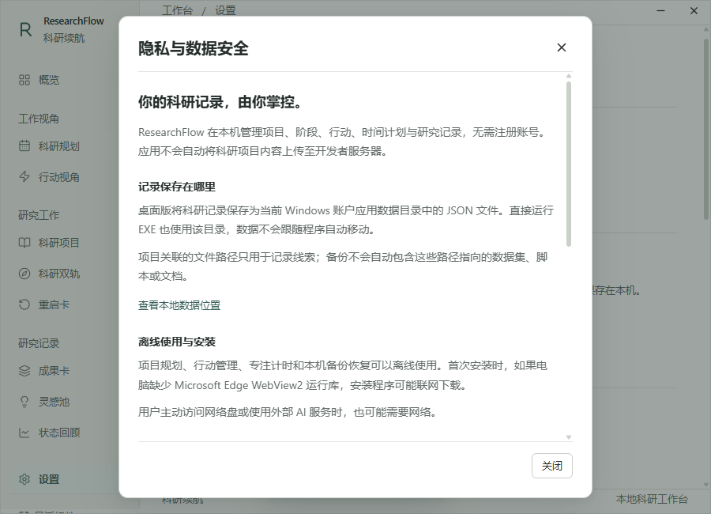

“查看本地数据位置”定位设置中的实际路径；“管理备份与恢复”定位现有备份区域。查看说明或路径不会创建科研记录。数据位置读取失败时，可点击“重新读取”。

### 本地保存不代表自动加密

ResearchFlow 无需账号，不自动上传科研项目内容；当前没有云同步、遥测、错误上传或自动更新检查。安装时若缺 WebView2，安装器可能联网下载。访问网络盘或自己使用外部 AI 也可能需要网络。

记录及备份是普通 JSON，未采用应用层加密。具有文件权限的其他程序可能读取它们。备份到云盘、共享目录或代码仓库前，确认该位置的访问范围。

### 使用外部 AI 或 Agent

AI 计划导入只准备提示词并读取计划 JSON，不直接连接 AI 服务。当你把资料发送给第三方 AI 时，内容由该平台处理；发送前检查未公开研究、患者身份与机构保密要求。

给 Codex、Cursor、Claude Code 等 Agent 授权时，只开放当前工作需要的目录。ResearchFlow 不监控或拦截第三方工具，不能代替操作系统管理文件权限。

Git 添加、提交和推送分别对应暂存、本地历史和远端发送。.gitignore 不能阻止文件读取，也不能清除已经提交或上传的内容。高级说明提供只读检查命令，软件不会自动执行。更多内容可阅读软件内的折叠说明或附带的隐私文档。

<!-- page -->

# 08 分享与安装：普通用户只需安装包

### 最方便的分享方式

把 ResearchFlow-1.7.2-Windows-x64-share.zip 发给对方。对方先解压，再双击其中的 ResearchFlow_1.7.2_x64-setup.exe 安装；说明书PDF和“先读我”也在里面。

如果不用分享ZIP，**单独发送安装包就足够安装软件**，建议同时发送本说明书。普通用户无需源码、开发缓存或你的整个researchflow文件夹。

### 三种分享目的

| 接收者 | 应分享什么 |
| --- | --- |
| 只想使用软件 | 当前1.7.2的x64-setup.exe，或整理好的share.zip |
| 想参与开发或修改 | ResearchFlow-1.7.2-source.zip，按README准备开发环境 |
| 想在另一台电脑继续自己的研究 | 安装包 + 自己导出的JSON；研究数据和脚本另行复制 |

安装包包含运行程序及依赖许可通知。若想直接复制运行程序，需要连同THIRD_PARTY_NOTICES.txt一起保留，目标机仍需WebView2；这一方式没有安装向导，不保证创建快捷方式，推荐新手使用安装包。

**桌面快捷方式不是程序。** 单独发ResearchFlow.lnk不会让对方安装或运行软件，它只指向你电脑上的位置。source.zip也不是安装包，解压源码不能直接启动应用。

### 对方电脑的要求

Windows 10 / Windows 11 x64；Microsoft Edge WebView2 Runtime。没有运行库时首次安装可能联网下载，不提供Mac、Linux或专门的Windows ARM64安装包。核心功能在安装完成后离线使用。

安装包和源码不包含你的科研记录；每台电脑的用户数据独立。同一台电脑的同一Windows账户共用应用数据，新装或直接运行不等于独立数据副本。

升级前先导出JSON并通过托盘“完全退出”旧程序，再运行新安装包。同一Windows账户下，新版沿用原数据目录；首次读取时保存升级前副本。不要先手工清空AppData，也不要勾选卸载程序的删除数据选项。移除软件前也先导出JSON，不把卸载当成备份策略。安装包已在开发机构建检查，其他电脑首次安装遇到问题时请保留提示信息反馈。

<!-- page -->

# 09 常见问题与日常用法

| 问题 | 处理方法 |
| --- | --- |
| 关闭后找不到软件 | 查看Windows托盘的R图标；点击恢复，或重新启动软件 |
| 首次启动提示运行库缺失 | 使用安装包安装，并允许安装向导获取WebView2；离线电脑需先准备官方运行库 |
| Windows显示未知发布者 | 当前没有商业签名；先核实提供者及文件来源，单位受管电脑按管理员规则安装 |
| 行动视角没有行动 | 选中一个进行中的项目并添加行动；手动聚焦的项目没有行动时不会跳到其他项目 |
| 已完成项目不见了 | 在科研项目勾选“显示完成与归档”，再搜索或展开 |
| 计划太多或三月内容看不全 | 月历点日期看详情；管理页向下滚动，三月时间轴可横向滚动 |
| 今天或剩余天数不正确 | 检查Windows日期与时区，返回软件重新聚焦；软件不单独设定当前时间 |
| 文件路径无法打开 | 文件可能已移动或来自其他电脑，重新编辑重启卡中的路径 |
| JSON恢复失败 | 数据备份须为ResearchFlow格式、不超过20MB；AI计划须为 researchflow-plan version 1、不超过1MB |
| 数据保存失败 | 先保留当前输入和错误信息；检查磁盘空间，必要时导出现有数据，不反复覆盖 |

### 推荐的一天

**开始时：** 看一眼科研规划，在行动视角主动选定今天的项目，再开始一项具体行动。

**工作中：** 按需要暂停，写下一句观察；不要用专注分钟数推断科研质量或论文完成百分比。

**结束时：** 保存本次专注，决定行动是否真的完成；需要中断项目时留下下次第一步。

**重要整理后：** 导出JSON备份。分享软件时发安装包，分享自己的研究时再明确选择相应备份或文件。

### 使用边界

系统睡眠/休眠、真实多显示器DPI尚未完成全面设备验证；异常断电可能丢失最近约30秒未落盘的专注时间。软件不提供小时排班、自动云同步、多人实时协作或自动更新服务。

如果某次操作没有成功提示，请保留输入和错误信息，不把界面关闭等同于保存。需要反馈问题时，提供版本、Windows版本、操作步骤和错误文字；截图前检查是否包含不宜分享的研究内容。
